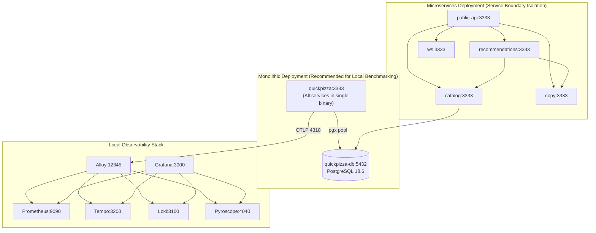

# Grafana QuickPizza: Target Application Architecture and Performance Analysis

**Document Status:** Approved Engineering Specification  
**Research Date:** 14 November 2026  
**Target Application Version:** Grafana QuickPizza  
**Target Repository:** `https://github.com/grafana/quickpizza`  
**Inspected Commit:** `a000faecae2201877b7a3fda4aaeb37848bb04d1` (Bump base image digests in Dockerfile)  
**Author:** Senior SDET / Performance Engineering Architect  

---

## 1. Executive Summary

Grafana QuickPizza is an open-source demonstration application built to showcase modern cloud-native observability, OpenTelemetry instrumentation, and performance testing methodologies. It simulates a distributed pizza recommendation and ordering engine.

This document establishes the verified architectural foundation, operational characteristics, API contracts, database schemas, authentication mechanisms, and baseline behaviors discovered through source-code inspection of the application. It serves as the primary technical baseline for all subsequent workload modeling, k6 performance scripts, Python statistical utilities, and observability integrations.

---

## 2. Target Application Architecture

### 2.1 Technology Stack

| Layer | Component / Technology | Specification & Role |
|---|---|---|
| **Runtime & Language** | Go 1.23+ (`net/http`, `go-chi/chi/v5`) | Core HTTP server, middleware chaining, routing, and business logic execution |
| **Frontend** | SvelteKit / Vite / Tailwind CSS | Embedded web application and asset serving (`/dev.html`, `/static/*`) |
| **Primary Datastore** | PostgreSQL 18.6 (or SQLite / In-Memory) | Relational store for users, catalog, doughs, ingredients, recommendations, ratings |
| **Telemetry & Observability** | OpenTelemetry Go SDK (`otelhttp`), OBI eBPF | Distributed tracing, spans, context propagation (`W3C TraceContext`) |
| **Metrics Storage** | Prometheus v3.15.0 | Scrapes application `/metrics`, ingests k6 metrics via Prometheus Remote Write receiver |
| **Log Aggregation** | Grafana Loki v3.7.8 | Ingests structured JSON logs emitted by QuickPizza via Grafana Alloy |
| **Distributed Tracing** | Grafana Tempo v3.1.1 | Stores trace spans received via OTLP gRPC/HTTP |
| **Continuous Profiling** | Grafana Pyroscope v1.21.1 | Captures CPU, memory, block, and mutex profiles from QuickPizza |
| **Telemetry Collector** | Grafana Alloy v1.20.0 | Local collector forwarding traces, logs, and database observability |
| **Visualization** | Grafana v13.0.1 | Pre-provisioned dashboards for k6 metrics, QuickPizza overview, logs, and traces |

### 2.2 Deployment Modalities

QuickPizza supports two official deployment topologies:

#### Monolithic Mode (`compose.grafana-local-stack.monolithic.yaml`)
- A single Go binary runs with `QUICKPIZZA_ENABLE_ALL_SERVICES=1`.
- Handles public routing, catalog queries, copy generation, pizza generation, and rating storage within the same process.
- Backed by PostgreSQL (`quickpizza-db:5432`).
- **Primary engineering advantage:** Eliminates inter-container network virtualization overhead when isolating database and CPU performance characteristics.

#### Microservices Mode (`compose.grafana-local-stack.microservices.yaml`)
- Splits functionality into distinct containerized services:
  - `public-api`: Entry proxy and session coordinator.
  - `catalog`: Manages users, ingredients, doughs, tools, and ratings.
  - `copy`: Generates pizza names, adjectives, and quotes.
  - `recommendations`: Executes pizza assembly algorithms.
  - `ws`: Handles WebSocket live connections.
  - `grpc`: Exposes internal gRPC endpoints.
- Useful for investigating microservice network hop latency, cascading timeouts, and service-to-service distributed traces.

---

## 3. Verified API Inventory

Source code verification of `pkg/http/http.go` and `quickpizza-openapi.yaml` confirms the following endpoints:

| Endpoint Path | HTTP Method | Auth Required | State Changing | Key Request Payload / Params | Response Codes | Performance Relevance |
|---|---|---|---|---|---|---|
| `/healthz` | `GET` | No | No | None | `200` | Liveness check; ultra-low latency baseline (<2ms) |
| `/ready` | `GET` | No | No | None | `200` | Readiness check; verifies service start |
| `/metrics` | `GET` | No | No | None | `200` | Prometheus metric scrape endpoint |
| `/api/pizza` | `POST` | Optional | Yes (records rec) | `Restrictions` JSON (`maxCalories`, `mustBeVegetarian`, excluded items) | `200`, `400`, `500`, `503` | **Core business transaction:** Generates pizza names, queries ingredients, calculates calories, writes to DB |
| `/api/pizza/{id}` | `GET` | No | No | Path parameter `id` (integer) | `200`, `400`, `404`, `500` | High-frequency read query for stored recommendations |
| `/api/ingredients/{type}` | `GET` | **Yes** (Token) | No | Path parameter `type` (`olive_oil`, `tomato`, `mozzarella`, `topping`) | `200`, `400`, `401`, `500` | Catalog query; exercises database connection pool and query cache |
| `/api/doughs` | `GET` | **Yes** (Token) | No | None | `200`, `401`, `500` | Reads dough catalog from DB |
| `/api/tools` | `GET` | **Yes** (Token) | No | None | `200`, `401`, `500` | Reads culinary tools catalog from DB |
| `/api/ratings` | `POST` | **Yes** (Token) | Yes (DB write) | `{"pizza_id": int, "stars": int}` | `201`, `400`, `401`, `500` | Critical write path; inserts user rating into PostgreSQL |
| `/api/ratings` | `GET` | **Yes** (Token) | No | None (user scoped) | `200`, `401`, `500` | Reads ratings created by the authenticated user |
| `/api/ratings/{id}` | `GET` | **Yes** (Token) | No | Path parameter `id` (integer) | `200`, `400`, `401`, `404`, `500` | Single-record lookup for rating |
| `/api/ratings/{id}` | `PUT`/`PATCH` | **Yes** (Token) | Yes (DB update) | `{"stars": int}` | `200`, `400`, `401`, `404`, `500` | Modifies existing rating |
| `/api/ratings/{id}` | `DELETE` | **Yes** (Token) | Yes (DB delete) | Path parameter `id` (integer) | `204`, `400`, `401`, `404`, `500` | Deletes single rating |
| `/api/users` | `POST` | No | Yes (DB write) | `{"username": str, "password": str}` | `201`, `400`, `500` | Registers user; hashes password with bcrypt |
| `/api/users/token/login` | `POST` | No | No | `{"username": str, "password": str}` | `200`, `400`, `401`, `500` | Verifies credentials, returns 16-char token |
| `/api/users/token/authenticate` | `POST` | **Yes** (Token) | No | Header `Authorization: Token <token>` | `200`, `401`, `500` | Token verification |
| `/api/names` | `GET` | No | No | None | `200`, `500` | Copy service; returns pizza naming nouns |
| `/api/adjectives` | `GET` | No | No | None | `200`, `500` | Copy service; returns pizza naming adjectives |
| `/api/quotes` | `GET` | No | No | None | `200`, `500` | Copy service; returns pizza quotes |
| `/api/delay/{delay}` | `GET` | No | No | Path parameter `delay` (Go duration, e.g. `200ms`) | `200` | Controlled latency testing |
| `/api/status/{status}` | `GET` | No | No | Path parameter `status` (HTTP code, e.g. `500`) | Status code | Controlled error injection |

---

## 4. Authentication Architecture and Findings

### 4.1 Token Specifications
- Tokens in QuickPizza are 16-character alphanumeric strings (`model.UserTokenLength = 16`).
- QuickPizza validates tokens via `s.AuthMiddleware(db)` on all routes registered in `AddCatalogHandler`:
  - Accepted Header Formats:
    - `Authorization: Token <16-char-token>`
    - `Authorization: Bearer <16-char-token>`
  - Accepted Cookie Format:
    - Cookie `qp_user_token=<16-char-token>`

### 4.2 Seeded Test Accounts
Source analysis of `pkg/database/migrations/catalog/testdata_load_test_users.yaml` confirms that QuickPizza automatically seeds **100 dedicated load-testing accounts** directly on database migration:

| User Range | Username Pattern | Password | Token Pattern |
|---|---|---|---|
| Master Default | `default` | *N/A (token only)* | `abcdef0123456789` |
| Load Test Users (1–100) | `user1` to `user100` | `quickpizza` | `loadtestuser0004` to `loadtestuser0103` |
| Studio User | `studio-user` | `k6studiorocks` | `oBGOPc5tVtk9WAgf` |

> [!IMPORTANT]
> **Performance Engineering Decision:**  
> In load testing, hammering `/api/users/token/login` on every single iteration creates artificial CPU saturation on bcrypt password hashing rather than testing application throughput.  
> The framework uses seeded user tokens distributed across Virtual Users (`loadtestuser0004` through `loadtestuser0103`), pre-warming sessions and testing authenticated business logic cleanly without redundant login overhead.

---

## 5. Verified User Journeys

### Journey 1: Pizza Recommendation Discovery (Read-Heavy / Business Critical)
1. User requests catalog ingredients (`/api/ingredients/tomato`, `/api/ingredients/mozzarella`, etc.).
2. User retrieves available dough types (`/api/doughs`) and culinary tools (`/api/tools`).
3. User posts recommendation constraints to `/api/pizza` (`maxCaloriesPerSlice`, `mustBeVegetarian`).
4. System validates rules, chooses ingredients, calculates calories, persists recommendation, and returns generated pizza ID.
5. User retrieves the saved recommendation via `/api/pizza/{id}`.

### Journey 2: Catalog Browsing (Pure Read-Only / High Concurrency)
1. User queries `/api/doughs`.
2. User queries `/api/tools`.
3. User queries all 4 ingredient types (`olive_oil`, `tomato`, `mozzarella`, `topping`).
4. User queries `/api/quotes`.

### Journey 3: Pizza Rating Lifecycle (State-Changing / CRUD)
1. User initiates a recommendation (`POST /api/pizza`) to obtain a valid `pizza_id`.
2. User submits rating (`POST /api/ratings` with `stars: 1-5`).
3. User verifies rating was persisted (`GET /api/ratings/{id}`).
4. User updates rating (`PUT /api/ratings/{id}`).
5. User deletes rating (`DELETE /api/ratings/{id}`) to maintain datastore hygiene and test data isolation.

### Journey 4: System Health and Observability
1. Monitoring probes `/healthz` and `/ready`.
2. Telemetry scrapers pull `/metrics`.

---

## 6. Built-In Fault and Chaos Injection Capabilities

QuickPizza includes native chaos hooks designed for controlled resilience and regression experiments:

### 6.1 Server Environment Injection
- `QUICKPIZZA_DELAY_RECOMMENDATIONS_API_PIZZA_POST`: Adds synthetic sleep duration to pizza generation.
- `QUICKPIZZA_FAIL_RATE_RECOMMENDATIONS_API_PIZZA_POST`: Fails `<N>%` of recommendation requests with HTTP 503.
- `QUICKPIZZA_FAIL_RATE_CATALOG_DATABASE_RECORD_RECOMMENDATION`: Fails `<N>%` of database writes with PostgreSQL syntax errors.

### 6.2 Client-Side Header Injection
- `x-delay-record-recommendation`: Injects exact delay (e.g. `250ms`).
- `x-delay-record-recommendation-percentage`: Sets probabilistic delay trigger rate (0-100%).
- `x-error-record-recommendation`: Injects synthetic error string.
- `x-error-record-recommendation-percentage`: Sets probabilistic error trigger rate (0-100%).

---

## 7. Analysis of Existing QuickPizza k6 Examples

Inspection of `/tmp/quickpizza/k6/` reveals:
- **Scope:** 17 isolated tutorial scripts in `foundations/` explaining individual k6 syntax features (e.g. `01.basic.js`, `04.metrics.js`, `08.arrival-rate.js`, `17.login-action.js`).
- **Deficiencies:**
  - In `run-tests.sh`, thresholds are explicitly disabled (`--no-thresholds`) because scripts were not calibrated against real system capacity.
  - Scripts execute single-endpoint loops without realistic session state, think times, or weighted user distributions.
  - Script `17.login-action.js` invokes login on every single iteration, overwhelming bcrypt rather than testing pizza business logic.
  - Zero post-run statistical analysis, automated percentile trends, baseline comparison, or HTML reporting.
  - Zero performance regression gating.

### Framework Value-Add
Our production-grade performance engineering framework bridges this gap by introducing:
1. Modular, object-oriented test architecture with reusable HTTP client abstractions, structured logging, and automatic error classification.
2. Calibrated workload models supporting 6 formal test disciplines (Smoke, Load, Stress, Spike, Soak, Regression).
3. Realistic, multi-journey weighted traffic with randomized think times.
4. Python statistical processing engine computing p50/p90/p95/p99 latency percentiles, throughput trends, error distributions, and resource correlations.
5. Automated regression comparison engine with noise tolerance, percentage change tracking, and pass/fail thresholds.
6. Executive HTML reporting with embedded SVG/PNG charts and JSON/CSV artifacts.
7. CI/CD integration with GitHub Actions workflows.

---

## 8. Technical Risks and Mitigations

| Risk | Impact | Engineering Mitigation |
|---|---|---|
| **Local CPU Contention** | Load generator (k6) and target (Docker QuickPizza) competing for same host CPU cores, skewing tail latency. | Allocate bounded CPU limits in Compose; measure generator memory/CPU; establish local benchmarking ceilings and clearly label local measurements. |
| **Bcrypt Login Bottleneck** | Repetitive authentication during high-volume tests saturates server CPU on crypto instead of testing API performance. | Utilize pre-seeded tokens (`loadtestuser0004` to `loadtestuser0103`) across VUs. Keep authentication tests isolated in specific auth scenarios. |
| **Database Bloat from Ratings** | Unbounded `POST /api/ratings` fills PostgreSQL disk and slows index scans over long soak tests. | Implement balanced CRUD lifecycles with cleanup (`DELETE /api/ratings/{id}`) in write journeys. |
| **Metric Cardinality Explosion** | Dynamic URLs with IDs (e.g. `/api/pizza/14295`) create millions of unique Prometheus series. | Use k6 URL tagging (`name: "/api/pizza/{id}"`) to ensure high-performance metric aggregation without high cardinality. |
