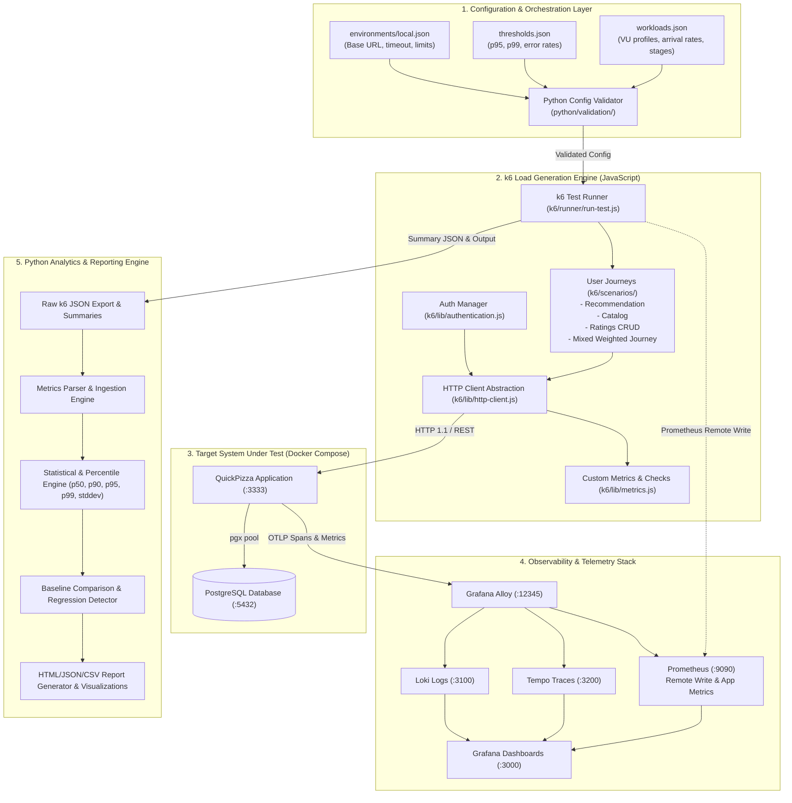

# Performance Engineering Framework Architecture

**Document Status:** Approved Architecture Blueprint  
**System Name:** Performance Engineering Framework — QuickPizza  
**Author:** Senior SDET / Performance Engineering Architect  

---

## 1. System Vision & Architectural Philosophy

The **QuickPizza Performance Engineering Framework** is a production-grade testing, measurement, and observability platform engineered to assess, stress, and monitor cloud-native web services. Rather than functioning as a collection of disjointed load test scripts, it is designed as a unified system with strict architectural separation among load generation, data synthesis, statistical analysis, and infrastructure telemetry.

### Core Architectural Principles
1. **Separation of Concerns:** Load generation (k6/JavaScript) is strictly decoupled from post-processing and reporting (Python).
2. **Measurement Integrity:** Never calculate percentiles from aggregated percentiles. All metrics must be computed from raw timestamped sample distributions or exact k6 summary histograms.
3. **Observability-Driven Engineering:** Load generation metrics alone cannot explain system behavior; they must be correlated with host/container telemetry (CPU, memory, database query times, trace spans).
4. **Reproducibility & Idempotence:** Given an identical workload profile and baseline environment, experiments must produce consistent, statistically comparable results.
5. **Safe by Design:** Execution defaults strictly to localhost, enforces maximum VU/duration caps, and strictly forbids unauthorized external targeting.

---

## 2. High-Level System Architecture



---

## 3. Layer Breakdown and Responsibilities

### 3.1 JavaScript / k6 Load Generation Layer (`k6/`)
- **Execution Engine:** Grafana k6 v2.4+ utilizing the Go-based JavaScript runtime (goja).
- **Core Responsibilities:**
  - Virtual User lifecycle coordination (setup, iteration, teardown).
  - Centralized HTTP Client abstraction with automatic request naming, header injection, correlation ID tracing, and response timing.
  - Multi-user authentication utilizing 100 pre-seeded accounts (`user1` to `user100`) to prevent bcrypt CPU bottlenecks.
  - Realistic user journey synthesis: Recommendation discovery (60%), Catalog browsing (20%), Rating lifecycle (10%), Health & system probes (10%).
  - Configurable stochastic think time (Pareto / Gaussian distributions) between interactions.
  - Custom business metrics: `recommendation_duration`, `rating_operation_duration`, `business_transaction_failures`.
  - Non-blocking summary generation (`handleSummary`) emitting structured JSON outputs for Python ingestion.

### 3.2 Python Analytics & Reporting Engine (`python/`)
- **Runtime:** Python 3.9+ with standard libraries, `matplotlib`, `jinja2`, and `pytest`.
- **Core Responsibilities:**
  - **Configuration Validation:** Pre-flight schema validation of workload and threshold configs before initiating runs.
  - **Result Ingestion:** Non-destructive parsing of raw k6 metric streams and structured summaries.
  - **Statistical Analysis:** Accurate calculation of true tail-latency percentiles ($p50, p90, p95, p99$), mean, variance, coefficient of variation, throughput (RPS), and error distributions.
  - **Baseline Governance:** Version-controlled baseline storage with execution metadata (host specs, container versions, duration, warm-up).
  - **Regression Detection:** Dual-threshold percentage change analysis ($\Delta \text{latency}$, $\Delta \text{throughput}$, $\Delta \text{error rate}$) with noise-filtering confidence bands.
  - **Reporting & Visualization:** Self-contained executive HTML reports, automated SVG/PNG time-series plots, JSON structured metrics, and CSV tabular summaries.

### 3.3 Infrastructure & Observability Layer (`docker/`)
- **Runtime:** Docker Engine 29+ & Docker Compose v5+.
- **Components:**
  - QuickPizza monolithic service (`quickpizza:3333`) backed by PostgreSQL 18.6 (`quickpizza-db:5432`).
  - Prometheus v3.15 with `--web.enable-remote-write-receiver` for real-time k6 metric ingestion.
  - Grafana v13 with auto-provisioned dashboards:
    - Dashboard 18030: k6 Prometheus Metrics & Live VUs.
    - QuickPizza Overview: Application latency, request rates, error distributions.
    - QuickPizza Logs: Structured log streams from Loki.

---

## 4. End-to-End Data Flow Pipeline

```text
[ workloads.json / thresholds.json / environments.json ]
                     │
                     ▼
         [ python -m python.cli validate ]  ──(Pre-flight validation)──┐
                     │                                                 │
                     ▼ (Pass)                                          ▼ (Fail)
     [ k6 run k6/runner/run-test.js ]                             [ Exit Code 1 ]
                     │
         ┌───────────┴───────────┐
         ▼                       ▼
  [ HTTP Traffic ]      [ Prometheus Remote Write ]
         │                       │
         ▼                       ▼
  [ QuickPizza + DB ]     [ Prometheus :9090 ]
         │                       │
         ▼                       ▼
[ App Telemetry OTLP ]   [ Grafana Dashboards :3000 ]
         │
         ▼
[ summary.json + raw-metrics.json ]
         │
         ▼
[ python -m python.cli analyze ]
         │
         ├─► [ Metric Parsing & Percentile Analysis ]
         ├─► [ Error Classification & Throughput ]
         ├─► [ Baseline Comparison (Delta % vs Baseline) ]
         ├─► [ Regression Classification: PASS | WARNING | REGRESSION ]
         │
         ▼
[ Final HTML Report + JSON Metrics + CSV Summary + Charts ]
```

---

## 5. Architectural Trade-offs & Decisions

### Decision 1: Monolithic vs Microservices Deployment for Benchmarking
- **Decision:** Utilize monolithic QuickPizza deployment as primary benchmark target, reserving microservices mode for distributed trace latency analysis.
- **Justification:** In local single-host testing, microservices add 6 extra containers competing for host CPU and memory, introducing Docker bridge networking overhead that skews millisecond-level tail latency. Monolithic deployment isolates Go application runtime and PostgreSQL performance directly.

### Decision 2: Pre-seeded User Accounts vs Runtime User Registration
- **Decision:** Distribute 100 pre-seeded load test accounts (`loadtestuser0004` to `loadtestuser0103`) across VUs.
- **Justification:** QuickPizza uses bcrypt for password hashing on `/api/users` and `/api/users/token/login`. Under high concurrency (>25 VUs), bcrypt hashing pegs CPU at 100% on the auth endpoint, creating a synthetic bottleneck in the test setup rather than measuring pizza catalog and recommendation performance. Pre-seeded tokens represent realistic logged-in user sessions.

### Decision 3: JSON File-Based Baseline Store vs Database
- **Decision:** Store baseline metrics and metadata as immutable JSON files in `baselines/`.
- **Justification:** JSON files in version control allow baselines to be peer-reviewed via Git Pull Requests, tagged alongside application releases, and operated without external database dependencies in CI/CD pipelines.

### Decision 4: Prometheus Remote Write alongside k6 JSON Summary
- **Decision:** Implement dual telemetry: k6 structured JSON summary (`handleSummary`) for deterministic offline Python processing, paired with Prometheus Remote Write for real-time live monitoring during test execution.
- **Justification:** Guarantees comprehensive live visibility in Grafana during long soak/stress tests without sacrificing deterministic, repeatable post-run analysis.
