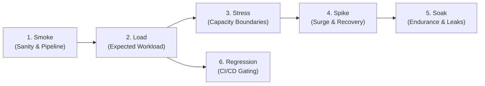

# QuickPizza Performance Testing Strategy

**Document Status:** Approved Strategy  
**System Name:** Performance Engineering Framework — QuickPizza  
**Author:** Senior SDET / Performance Engineering Architect  

---

## 1. Scope & Strategy Overview

This strategy outlines the systematic methodology for testing the performance, scalability, reliability, and resilience of the Grafana QuickPizza application.

Performance testing is not a single execution of load; it is a discipline comprising distinct testing categories, each with tailored objectives, workload shapes, operational parameters, and acceptance criteria.

---

## 2. Test Disciplines & Execution Matrices

### 2.1 Smoke Testing (Sanity & Integrity)
- **Primary Goal:** Verify test infrastructure, authentication token validation, environment readiness, and functional response schemas under minimal load before initiating costly tests.
- **Workload:** 1–2 VUs for 30–60 seconds.
- **Pass Criteria:**
  - 100% check pass rate (`checks: rate > 0.99`).
  - 0% HTTP request failures (`http_req_failed: rate == 0`).
  - p95 response time $< 200\text{ ms}$.

### 2.2 Load Testing (Operational Performance)
- **Primary Goal:** Measure system performance under the expected normal operational workload. Establish steady-state response time percentiles, throughput ceilings, and resource utilization.
- **Workload:** Ramping from 0 to 25 VUs, 5-minute steady-state, 1-minute ramp-down.
- **Pass Criteria:**
  - HTTP failure rate $< 1.0\%$ (`http_req_failed: rate < 0.01`).
  - Overall p95 response time $< 500\text{ ms}$.
  - Overall p99 response time $< 1000\text{ ms}$.
  - Pizza recommendation transaction p95 $< 800\text{ ms}$.
  - Zero unhandled 5xx internal server errors.

### 2.3 Stress Testing (Failure Boundary Exploration)
- **Primary Goal:** Identify the saturation inflection point where throughput plateaus and response times degrade non-linearly. Determine the maximum successfully sustained load before system failure.
- **Workload:** Stepped increments from 10 to 100 VUs in stages.
- **Evaluation Criteria (Exploratory):**
  - Stress testing is **exploratory**, not purely pass/fail.
  - Saturation Boundary defined as: The VU level where p95 latency doubles baseline or error rate exceeds 5%.
  - Safety Stop Condition: Automatic test abort if error rate $> 15\%$ or p95 $> 3000\text{ ms}$.

### 2.4 Spike Testing (Surge Resilience & Recovery)
- **Primary Goal:** Subject the application to an immediate 10x traffic burst, observing whether connection pools saturate, requests drop, and how quickly the system recovers once load subsides.
- **Workload:** Baseline at 5 VUs $\rightarrow$ 10s surge to 50 VUs $\rightarrow$ 1m hold $\rightarrow$ 10s drop to 5 VUs $\rightarrow$ 1m recovery hold.
- **Evaluation Criteria:**
  - Maximum error rate during spike $< 5\%$.
  - Post-spike recovery time $< 15\text{ seconds}$ to return to baseline latency ($\pm 10\%$).
  - Zero container crashes or unrecoverable database locks.

### 2.5 Soak Testing (Endurance & Resource Leaks)
- **Primary Goal:** Detect slow memory leaks, goroutine leaks, unclosed database connection pools, or query performance degradation caused by table growth over extended durations.
- **Workload:** Constant 15 VUs for 15 minutes (standard local execution) or 60 minutes (extended benchmark).
- **Evaluation Criteria:**
  - Memory consumption slope: Linear regression slope of memory growth should be near zero after initial warm-up.
  - p95 response time stability: Latency in the final 5 minutes must not exceed initial steady-state latency by more than 15%.
  - Zero cumulative connection exhaustion errors.

### 2.6 Performance Regression Testing (Continuous Gating)
- **Primary Goal:** Automated comparison between a newly executed test run and an approved historical baseline. Detect statistical regressions in CI/CD before deployment.
- **Workload:** Standardized, deterministic 15 VU workload for 2 minutes.
- **Evaluation Criteria:**
  - Latency Regression: Regressed if p95 increases by $> 15\%$ and absolute difference $> 50\text{ ms}$.
  - Throughput Degradation: Regressed if RPS decreases by $> 10\%$.
  - Error Regression: Regressed if error rate increases by $> 0.5\%$.

---

## 3. Threshold Calibrations by Test Profile

| Metric | Smoke Profile | Load Profile | Stress Profile | Spike Profile | Soak Profile | Regression Profile |
|---|---|---|---|---|---|---|
| `http_req_failed` | `rate == 0` | `rate < 0.01` | `rate < 0.15` | `rate < 0.05` | `rate < 0.02` | `rate < 0.01` |
| `http_req_duration (p95)` | `< 200ms` | `< 500ms` | `< 3000ms` | `< 1500ms` | `< 600ms` | `< 500ms` |
| `http_req_duration (p99)` | `< 500ms` | `< 1000ms` | `< 5000ms` | `< 3000ms` | `< 1200ms` | `< 1000ms` |
| `checks` (functional pass) | `rate > 0.99` | `rate > 0.95` | `rate > 0.85` | `rate > 0.90` | `rate > 0.95` | `rate > 0.98` |

> [!NOTE]
> These thresholds represent provisional engineering criteria calibrated against observed local baseline capabilities. They distinguish functional failures from capacity explorations.

---

## 4. Responsible Testing & Safety Governance

1. **Target Allowlisting:** All k6 tests and scripts validate `BASE_URL`. Default is strictly `http://localhost:3333`. Running against any public host (`quickpizza.grafana.com` or third-party) is blocked unless an explicit `ALLOW_EXTERNAL_TARGET=true` environment flag is provided with a warning acknowledgement.
2. **Resource Boundaries:** Hard upper limits are enforced in the runner: maximum 150 VUs and maximum 60 minutes duration to avoid destabilizing the host system.
3. **Data Hygiene:** State-changing journeys (Ratings CRUD) immediately delete created entities at the end of each iteration to prevent database bloat.
4. **Credential Isolation:** No tokens or passwords are committed to version control; `.env.example` provides templates.
