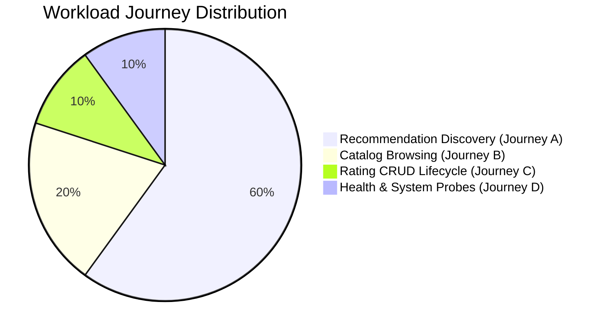

# QuickPizza Workload Model and Capacity Architecture

**Document Status:** Approved Workload Engineering Specification  
**System Name:** Performance Engineering Framework — QuickPizza  
**Author:** Senior SDET / Performance Engineering Architect  

---

## 1. Executive Summary and Principles

Workload modeling is the cornerstone of performance engineering. Arbitrary concurrency numbers (e.g. running 500 VUs simply because a machine can spawn them) produce meaningless numbers that do not reflect real-world user behavior.

This document establishes the formal mathematical and behavioral workload model for QuickPizza. It models:
1. Target user population personas and behavior.
2. Weighted user journeys.
3. Concurrency, arrival rates, and Little's Law derivation.
4. Stochastic think times.
5. Workload profiles across all six performance testing disciplines.

---

## 2. Mathematical Foundation: Little's Law & Concurrency

### 2.1 The Closed vs Open Model Distinction

A common flaw in load testing is confusing **Closed Models** (VU-based) with **Open Models** (Arrival-rate based):

| Model Type | k6 Executor | Behavioral Characteristic | Real-World Analog |
|---|---|---|---|
| **Closed Workload** | `constant-vus`, `ramping-vus` | The next request from a user is triggered only *after* the previous response is received + think time. System degradation slows down arrival rate. | Internal back-office users, batch workers, stateful web portal sessions. |
| **Open Workload** | `constant-arrival-rate`, `ramping-arrival-rate` | Requests arrive at a fixed or ramping frequency independent of system response time. System degradation queues or drops requests. | Public e-commerce websites, API gateways, mobile app traffic spikes. |

Our framework supports both paradigms:
- **VU-based (Closed):** Used for realistic user session simulations, soak testing, and baseline regression.
- **Arrival-Rate (Open):** Used for stress and spike testing to observe true queuing and saturation boundaries without client-side self-throttling.

### 2.2 Little's Law Formulation

For closed interactive systems, Little's Law relates concurrency ($N$), throughput ($X$), response time ($R$), and user think time ($Z$):

$$N = X \times (R + Z)$$

Where:
- $N$ = Number of concurrent Virtual Users (VUs).
- $X$ = Throughput in completed user iterations per second.
- $R$ = System response time per iteration (sum of endpoint latencies).
- $Z$ = User think time per iteration (delays between user actions).

#### Example Calculation:
For an expected iteration latency $R = 0.25\text{ s}$ across 4 requests, with total think time $Z = 1.75\text{ s}$:
$$\text{Cycle Time } (R + Z) = 2.0\text{ s}$$
With $N = 20\text{ VUs}$, expected steady-state throughput:
$$X = \frac{N}{R + Z} = \frac{20}{2.0} = 10\text{ iterations/second}$$
Since each iteration executes an average of 4 HTTP requests, the expected request rate:
$$\text{RPS} = 10 \times 4 = 40\text{ req/s}$$

---

## 3. User Journeys & Distribution Matrix

User interactions are divided into four distinct operational journeys:

### Detailed Journey Specifications

| Journey ID | Name | Weight | Primary Operations | Read/Write Ratio | State Impact |
|---|---|---:|---|---|---|
| **Journey A** | Recommendation Discovery | **60%** | 1. Retrieve ingredients (`/api/ingredients/tomato`) 2. Retrieve doughs (`/api/doughs`) 3. Request recommendation (`POST /api/pizza`) 4. Fetch saved pizza (`GET /api/pizza/{id}`) | 75% Read / 25% Write | Persists 1 pizza recommendation to catalog |
| **Journey B** | Catalog Browsing | **20%** | 1. Retrieve dough catalog (`/api/doughs`) 2. Retrieve tools catalog (`/api/tools`) 3. Retrieve multiple ingredients 4. Read pizza quotes (`/api/quotes`) | 100% Read | Pure read-only; tests DB read throughput |
| **Journey C** | Pizza Rating Lifecycle | **10%** | 1. Request recommendation (`POST /api/pizza`) 2. Submit rating (`POST /api/ratings`) 3. Query rating (`GET /api/ratings/{id}`) 4. Update rating (`PUT /api/ratings/{id}`) 5. Delete rating (`DELETE /api/ratings/{id}`) | 40% Read / 60% Write | Balanced CRUD; maintains DB cleanliness |
| **Journey D** | Health & System Probes | **10%** | 1. Liveness check (`GET /healthz`) 2. Readiness check (`GET /ready`) 3. Prometheus metrics (`GET /metrics`) | 100% Read | Evaluates control plane and telemetry latency |

---

## 4. Think Time Modeling

To avoid artificial hammering that does not reflect human interaction, randomized think times are introduced between user actions:

- **Distribution:** Uniform randomized distribution within bounded intervals:
  - Fast action (e.g. browsing between catalog tabs): `0.2s - 0.6s`
  - Normal consideration (e.g. reviewing pizza recommendation): `1.0s - 2.5s`
  - Rating decision (e.g. selecting stars and submitting): `1.5s - 3.0s`
- **Configuration:** Think time bounds are fully parameterizable via `config/workloads.json` without modifying k6 JavaScript test code.

---

## 5. Workload Profiles Across Test Disciplines

### 5.1 Smoke Profile (`smoke`)
- **Objective:** Environmental sanity, credential validation, response integrity, and metric pipeline check.
- **Executor:** `constant-vus`
- **Parameters:**
  - VUs: `2`
  - Duration: `30s`
  - Think Time: `0.5s - 1.0s`
- **Expected Throughput:** ~2 to 4 RPS.

### 5.2 Standard Load Profile (`load`)
- **Objective:** Evaluate system behavior under normal expected operational workload.
- **Executor:** `ramping-vus`
- **Stages:**
  - Stage 1: Ramp-up from 0 to 10 VUs over 1 minute.
  - Stage 2: Ramp-up from 10 to 25 VUs over 2 minutes.
  - Stage 3: Steady-state at 25 VUs for 5 minutes.
  - Stage 4: Ramp-down from 25 to 0 VUs over 1 minute.
- **Total Duration:** 9 minutes (configurable to 2-3 min for rapid CI).
- **Expected Throughput:** ~35 to 60 RPS at steady state.

### 5.3 Progressive Stress Profile (`stress`)
- **Objective:** Identify saturation inflection points, connection queuing, and failure boundaries.
- **Executor:** `ramping-vus`
- **Stages:**
  - Stage 1: 0 to 10 VUs over 30s.
  - Stage 2: 10 to 30 VUs over 1m.
  - Stage 3: 30 to 60 VUs over 1m.
  - Stage 4: 60 to 100 VUs over 1m (Exploration).
  - Stage 5: Ramp-down to 0 over 30s.
- **Stop Condition:** Abort automatically if error rate exceeds 15% or p95 latency exceeds 3000ms.

### 5.4 Sudden Spike Profile (`spike`)
- **Objective:** Measure response degradation, recovery time, and container resilience under sudden traffic surges.
- **Executor:** `ramping-vus`
- **Stages:**
  - Stage 1: Baseline 5 VUs for 1 minute.
  - Stage 2: Sharp surge to 50 VUs over 10 seconds.
  - Stage 3: Sustained surge at 50 VUs for 1 minute.
  - Stage 4: Rapid recovery drop to 5 VUs over 10 seconds.
  - Stage 5: Post-spike observation at 5 VUs for 1 minute.
- **Key Metric:** Recovery duration (time to return to baseline latency after drop).

### 5.5 Sustained Soak Profile (`soak`)
- **Objective:** Detect memory leaks, goroutine accumulation, connection pool leaks, or gradual query degradation over extended duration.
- **Executor:** `constant-vus`
- **Parameters:**
  - VUs: `15`
  - Duration: `15m` (standard test) or `60m` (extended test).
  - Think Time: `1.0s - 2.0s`.
- **Target Analysis:** Slope of memory consumption over time; slope of p95 response time over time.

### 5.6 Baseline Regression Profile (`regression`)
- **Objective:** Compare exact, reproducible workload against approved baseline.
- **Executor:** `ramping-vus`
- **Stages:**
  - Stage 1: Warm-up from 0 to 15 VUs over 30s (discarded or flagged).
  - Stage 2: Steady-state at 15 VUs for 2 minutes.
  - Stage 3: Ramp-down to 0 over 15s.
- **Parameters:** Fixed seeds, identical journey weights, deterministic payload sizes.
